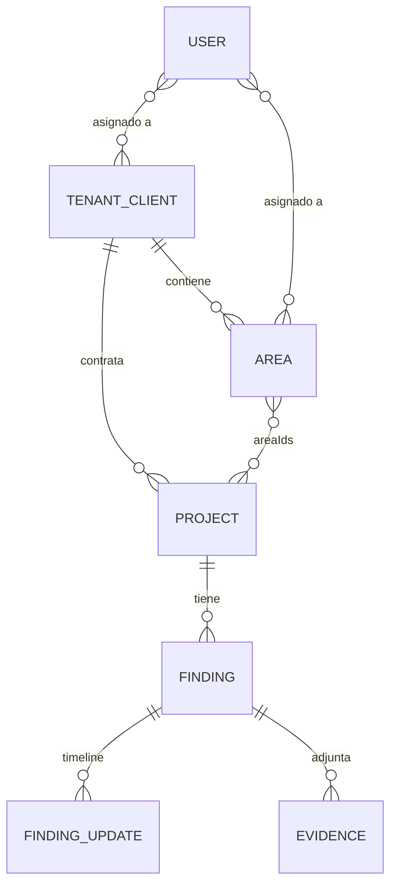

# Arquitectura de ShieldTrack

Descripción técnica del sistema tal como está implementado. Para instalar ver [SETUP.md](SETUP.md); para desplegar, [DEPLOYMENT.md](DEPLOYMENT.md).

---

## 1. Vista general

```mermaid
flowchart LR
    U[Navegador] -->|HTTP :FRONTEND_PORT| F

    subgraph Docker Compose · shieldtrack-network
      F["frontend<br/>Nginx + Angular 20 (SPA)"]
      B["backend<br/>NestJS 11 · Node 22"]
      M[("mongodb<br/>MongoDB 8")]
      F -->|"/api/* → backend:3000"| B
      B -->|Mongoose| M
    end

    B -->|SMTP| S[Servidor de correo]
    B --- V1[/"volumen evidence_uploads"/]
    B --- V2[/"volumen backups_data"/]
    M --- V3[/"volumen mongodb_data"/]
```

| Capa | Tecnología | Detalle |
| --- | --- | --- |
| Frontend | Angular 20 (standalone components, Signals), Angular Material 20 | Compilado a estáticos y servido por Nginx. `environment.apiUrl = /api`. |
| Proxy | Nginx (`nginx:alpine`) | SPA fallback a `index.html`; `/api/` → `backend:3000`; límite de cuerpo 110 MB. Ver [frontend/nginx.conf](../frontend/nginx.conf). |
| Backend | NestJS 11, TypeScript, Mongoose 8 | API REST con prefijo `/api`, Swagger en `/api/docs`. |
| Base de datos | MongoDB 8 | Una sola base `shieldtrack`, multi-tenant lógico por `tenantId`. |
| Archivos | Disco local del contenedor | Evidencias en `/app/backend/uploads/evidence`, respaldos en `/app/backend/backups` (volúmenes Docker). |
| Tareas programadas | `@nestjs/schedule` | Notificaciones de retest (09:00) y respaldo automático (02:00), en el mismo proceso del backend. |

No hay colas, caché ni servicios externos además de SMTP.

---

## 2. Backend

### 2.1 Arranque ([backend/src/main.ts](../backend/src/main.ts))

1. Conecta a MongoDB con reintentos (`MongoDBConnectionService`); si no lo logra, el proceso termina con código 1.
2. Registra el plugin global de Mongoose `tenantPlugin`.
3. Configura:
   - Límite de cuerpo JSON y urlencoded de 25 MB, pensado para logos y favicons en base64.
   - `ValidationPipe` global con `whitelist`, `forbidNonWhitelisted`, `transform` e `enableImplicitConversion`. Un campo extra en el body responde 400.
   - `HttpExceptionFilter` y `AuditInterceptor` globales.
4. CORS: se permiten los orígenes de `CORS_ORIGINS` (o `FRONTEND_URL` si no está definida) y las peticiones sin `Origin`. Con `NODE_ENV` distinto de `production` se acepta cualquier origen.
5. Publica Swagger en `/api/docs` y escucha en `PORT` (3000). `GET /` redirige a `/api/docs`.

### 2.2 Módulos (`backend/src/modules/`)

| Módulo | Ruta base | Responsabilidad |
| --- | --- | --- |
| `auth` | `/api/auth` | Login JWT, MFA (TOTP), recuperación de contraseña por código, perfil, CRUD de usuarios, asignaciones usuario↔cliente/área/proyecto, cambio de tenant activo. |
| `client` | `/api/clients` | Clientes. **Cliente = tenant** en la lógica de negocio. |
| `area` | `/api/areas` | Áreas dentro de un tenant; definen el prefijo del código de hallazgo (`findingCodePrefix`). |
| `project` | `/api/projects` | Proyectos o engagements, política de retest, cierre (que cierra también sus hallazgos) y fusión de proyectos. |
| `finding` | `/api/findings` | Hallazgos, timeline, cierre individual y masivo, importación CSV/XLSX (`bulk-import`). |
| `evidence` | `/api/evidence` | Subida y descarga de archivos de evidencia, y evidencias de tipo enlace externo. |
| `export` | `/api/export` | Exportaciones CSV, Excel (exceljs), JSON, ZIP con evidencias y PDF (pdfmake). |
| `template` | `/api/templates` | Plantillas de hallazgo con alcance USER, TENANT o GLOBAL. |
| `notification` | `/api/notifications` | Reglas y plantillas de notificación por correo. |
| `email` | — | Envío de correos con nodemailer y plantillas `.hbs`. Lee la configuración SMTP desde la base de datos. |
| `retest-scheduler` | — | Cron diario a las 09:00. Avisa los retest próximos según `retestPolicy.notify.offsetDays`. |
| `backup` | `/api/backup` | `mongodump`/`mongorestore`. Cron diario a las 02:00 que conserva los últimos 30 respaldos. Solo OWNER. |
| `metrics` | `/api/metrics` | Indicadores agregados con exportación CSV/JSON. Solo OWNER. |
| `audit` | `/api/audit` | Consulta del log de auditoría que alimenta `AuditInterceptor`. |
| `system-config` | `/api/system-config` | Configuración SMTP (con prueba de envío), branding (logo, favicon, colores) y reinicio de la base. |
| `custom-role` | `/api/custom-roles` | Roles personalizados (experimental; ver §6). |
| `tenant` | — | Solo el schema `Tenant`. No expone endpoints. |

### 2.3 Infraestructura común (`backend/src/common/`)

| Carpeta | Contenido |
| --- | --- |
| `rbac/` | `rbac-policy.ts`: grupos de roles, matriz de permisos, `normalizeRole()` y `roleSatisfies()`. `qa-client-scope.ts`: restricción de QA a su cliente. |
| `guards/` | `TenantContextGuard` (global): resuelve el tenant activo. |
| `middleware/` | `TenantContextMiddleware`: abre el contexto de tenant por request. |
| `interceptors/` | `TenantContextInterceptor` (global). |
| `plugins/` | `tenantPlugin` (global) y `multiTenantPlugin` (por schema): filtran automáticamente por `tenantId`. |
| `filters/` | `HttpExceptionFilter`: formato uniforme de errores. |
| `services/` | `MongoDBConnectionService` (conexión con reintentos) y `PdfService` (pdfmake + sharp). |
| `enums/` | Todos los enums del dominio. |

---

## 3. Multi-tenancy

Una sola base de datos. Cada entidad de negocio lleva `tenantId` (`clientId` se mantiene como campo legacy). El aislamiento se aplica en tres capas:

1. **Middleware y guard.** Resuelven el tenant del request en este orden de prioridad:
   1. Cabecera `X-Tenant-Id`.
   2. `activeTenantId` del usuario.
   3. `clientId` del usuario.
   4. `tenantIds[0]` del usuario.

   OWNER/PLATFORM_ADMIN y los roles operacionales (PENTESTER, QA, ANALYST, AUDITOR, ADMIN_AREA) pueden operar sin tenant fijo; su alcance se limita después por asignaciones.
2. **Plugins Mongoose.** Agregan `{ tenantId }` a las consultas y a los `$match` de agregaciones. Para una consulta deliberadamente cross-tenant se usa `.setOptions({ skipTenantFilter: true })`.
3. **Servicios.** Validan el alcance del usuario (clientes, áreas y proyectos asignados) antes de leer o modificar.

Reglas: el `tenantId` de un hallazgo se deriva **siempre del proyecto**, nunca del valor que envía el cliente. OWNER no se filtra por tenant en los listados.

Detalle y compatibilidad legacy: [MULTI-TENANCY.md](MULTI-TENANCY.md).

---

## 4. Modelo de datos



| Entidad | Campos clave |
| --- | --- |
| **Client** (tenant) | `name`, `code`, datos de contacto, `isActive` |
| **Area** | `tenantId`, `name`, `code`, `findingCodePrefix`, `isActive` |
| **Project** | `tenantId` (obligatorio), `areaIds[]`, `name`, `code`, `serviceArchitecture`, `projectStatus` (`ACTIVE` · `CLOSED` · `ARCHIVED`), `retestPolicy { enabled, nextRetestAt, notify { recipients[], offsetDays[] } }` |
| **Finding** | `tenantId`, `projectId`, `code`, `title`, `severity` (`CRITICAL` · `HIGH` · `MEDIUM` · `LOW` · `INFORMATIONAL`), `status` (`OPEN` · `IN_PROGRESS` · `RETEST_REQUIRED` · `RETEST_PASSED` · `RETEST_FAILED` · `CLOSED`), `retestIncluded`, `closeReason` (`FIXED` · `RISK_ACCEPTED` · `FALSE_POSITIVE` · `CONTRACT_ENDED` · `OUT_OF_SCOPE` · `DUPLICATE`) |
| **FindingUpdate** | `findingId`, `type` (`FOLLOWUP` · `TECHNICAL` · `STATUS_CHANGE` · `COMMENT`), `content`, `previousStatus` / `newStatus`, `createdBy`. Es inmutable: forma el timeline. |
| **Evidence** | `findingId`, `evidenceType` (`FILE` · `LINK`), `filename` (original), `filePath` o `externalUrl`, `mimeType`, `size`, `uploadedBy` |
| **User** | `email`, `password` (bcrypt), `role`, `clientId` / `activeTenantId` / `tenantIds`, `areaIds`, `visibleProjectIds`, `mfaEnabled`, `isActive` |
| **AuditLog** | Acción, entidad, usuario, IP y metadatos de cada mutación |
| **SystemConfig** | Configuración SMTP (usuario y contraseña cifrados con AES-256) y branding |
| **Counter** | Secuencias atómicas para los códigos de hallazgo |

### Código de hallazgo

El hook `pre('save')` de `Finding` asigna `PREFIJO-AÑO-NNNNNN` (ej. `VULN-2026-000001`):

- El prefijo es el `findingCodePrefix` del área del proyecto; si no hay, se usa `VULN`.
- La secuencia sale de la colección `counters` (clave `findings:<prefijo>:<año>`) con `findOneAndUpdate` + `$inc`.

Por eso **los hallazgos se crean siempre con `.save()` uno a uno, nunca con `insertMany`**. La importación masiva también lo hace así.

---

## 5. Flujos principales

### Cierre de proyecto

No hay un endpoint dedicado: el proyecto se cierra con `PUT`/`PATCH /api/projects/:id` y `projectStatus: CLOSED`. `ProjectService.update`:

1. Pasa a `CLOSED` todos los hallazgos no cerrados del proyecto, con `closeReason: CONTRACT_ENDED` y `closedAt` (un solo `updateMany`).
2. Desactiva `retestPolicy.enabled`, así el scheduler deja de notificar.
3. Guarda el proyecto.

No usa transacción de Mongo (el contenedor corre Mongo standalone). Si falla el paso 3, los hallazgos ya quedaron cerrados.

### Notificación de retest

Todos los días a las 09:00 (hora del contenedor) el scheduler:

1. Toma los proyectos `ACTIVE` con `retestPolicy.enabled`.
2. Si faltan exactamente `offsetDays` días para `nextRetestAt`, envía un correo a `notify.recipients` con los hallazgos abiertos marcados `retestIncluded`.

Requiere SMTP configurado.

### Evidencias

- `POST /api/evidence/upload` (multipart):
  - Valida la extensión: pdf, log, txt, imágenes, zip/rar/7z, office, json, xml, csv, mp4/webm/mov.
  - Valida el tamaño (`EVIDENCE_MAX_FILE_SIZE_MB`, 100 MB por defecto).
  - Guarda el archivo con nombre aleatorio. Las imágenes grandes se recomprimen a WebP si el resultado es menor.
- `POST /api/evidence/link`: registra una URL externa, útil para videos pesados.
- `GET /api/evidence/:id/download`: requiere JWT y valida el acceso al hallazgo. Los archivos no se sirven como estáticos.

### Importación masiva de hallazgos

`POST /api/findings/bulk-import` recibe un `.csv` o `.xlsx`:

- Roles permitidos: OWNER, PLATFORM_ADMIN, PENTESTER, QA y ANALYST.
- Admite `dryRun` para previsualizar sin escribir.
- Resuelve o crea el cliente y el proyecto a partir de las columnas del archivo.
- Crea cada hallazgo con `.save()`.

### Respaldos

- **Automático:** todos los días a las 02:00, con `mongodump --gzip --archive` hacia `/app/backend/backups`.
- **Manual:** desde **Administración → Respaldos** (`/admin/backup`).
- **Restauración:** `mongorestore --drop`.

Los respaldos **no incluyen los archivos de evidencia**: ese volumen se respalda aparte (ver [OPERATIONS.md](OPERATIONS.md#respaldos-y-restauración)).

---

## 6. Seguridad

| Aspecto | Implementación |
| --- | --- |
| Autenticación | JWT HS256 (`JWT_SECRET`, expira en `JWT_EXPIRES_IN`, 8h por defecto). El frontend lo guarda en `localStorage` y lo envía como `Authorization: Bearer`. En `production` el backend no arranca sin `JWT_SECRET`. |
| Contraseñas | bcrypt (coste 10). La recuperación usa un código de 6 dígitos válido por 15 minutos, con espera de 60 s entre reenvíos y respuesta genérica (no revela si el correo existe). |
| MFA | TOTP (speakeasy + QR) implementado en la API (`POST /api/auth/mfa/setup` y `/mfa/enable`). No es obligatorio para ningún rol. |
| Autorización | `@Roles()` + `RolesGuard` con `roleSatisfies()`: el grupo OWNER satisface cualquier rol. Además, validación de alcance en los servicios. Ver [RBAC-PERMISSIONS-MATRIX.md](RBAC-PERMISSIONS-MATRIX.md). |
| Auditoría | `AuditInterceptor` registra todo POST/PUT/PATCH/DELETE y las exportaciones. |
| Validación | DTOs con class-validator; el body se valida contra una whitelist. |

### Roles

Los roles canónicos son OWNER, ADMIN_AREA, PENTESTER, QA y AUDITOR. Los roles antiguos siguen aceptándose como alias del grupo correspondiente; en código, compara siempre con `normalizeRole()` y `roleSatisfies()`:

| Grupo | Roles |
| --- | --- |
| OWNER | `OWNER`, `PLATFORM_ADMIN` |
| ADMIN_AREA | `ADMIN_AREA`, `CLIENT_ADMIN`, `AREA_ADMIN` |
| PENTESTER_QA | `PENTESTER`, `QA`, `ANALYST` |
| AUDITOR | `AUDITOR`, `VIEWER` |

### Limitaciones conocidas (deuda técnica)

| Punto | Estado actual |
| --- | --- |
| Rate limiting | Hay decoradores `@Throttle` en evidence, export y backup, pero `ThrottlerGuard` no está registrado, así que **no se aplica ningún límite**. |
| Bloqueo de cuenta | La pantalla de configuración muestra "intentos de login fallidos", pero el backend **no bloquea** cuentas tras intentos fallidos. |
| Cabeceras HTTP | No se usa `helmet`, y Nginx no agrega cabeceras de seguridad. |
| Health check | No hay endpoint `/health`. Jenkins usa `/api/docs`; `GET /api/system-config/branding` es público y sirve para comprobar API + base (`/api/projects/ping` exige JWT). |
| JWT por query string | La estrategia JWT acepta `?token=` (lo usan las descargas), por lo que el token puede quedar en logs de proxies. |
| Credenciales de prueba | `login.component.ts` contiene `DEV_USERS` con las contraseñas de los seeds. El panel está oculto, pero las credenciales viajan en el bundle. |
| Clave SMTP | `SMTP_ENCRYPTION_KEY` tiene un valor por defecto en el código; en producción hay que definirla (ver [DEPLOYMENT.md](DEPLOYMENT.md)). |
| MFA sin interfaz | El frontend no tiene pantalla para activar MFA (`AuthService.setupMfa()` no se usa) ni existe una ruta para desactivarlo. |
| Roles personalizados | `CustomRoleService.hasPermission()` no evalúa permisos reales. |
| Código muerto | `backend/src/modules/user/` no tiene módulo ni se importa; `user-create-dynamic.component.ts` no se usa. |

Estos puntos deberían pasar al backlog ([ISSUES.md](../ISSUES.md)) antes de exponer la plataforma a Internet.

---

## 7. Frontend

- **Estructura:**
  - `src/app/core/`: servicios (`auth`, `finding`, `project`, `branding`, `theme`), guards (`authGuard`, `TenantRouteGuard`) e interceptor (`authInterceptor`).
  - `src/app/features/`: pantallas, cargadas con lazy loading.
  - `src/app/shared/`: utilidades, entre ellas `domain-normalizers.ts`, que compatibiliza campos legacy y canónicos (`tenantId`/`clientId`, `areaId`/`areaIds`, `mimeType`/`mimetype`).
- **Rutas principales:**
  - `/login`
  - `/dashboard`
  - `/clients`
  - `/projects`
  - `/findings`, con `/findings/new` (asistente), detalle, edición y timeline
  - `/templates`
  - `/profile`
  - `/admin/*`: users, areas, templates, notifications, audit, config, branding y backup
- **Estado:** Signals (`signal`, `computed`); sin NgRx ni NgModules.
- **API:** siempre relativa a `/api`. En desarrollo, `ng serve` usa [proxy.conf.json](../frontend/proxy.conf.json) hacia `http://localhost:3000`. En Docker, Nginx hace el proxy.
- `environment.prod.ts` existe, pero `angular.json` no tiene `fileReplacements`, así que todos los builds usan `/api`.

---

## 8. Decisiones de diseño

| Decisión | Motivo | Contrapartida |
| --- | --- | --- |
| Multi-tenant lógico (una base) | Operación, backups y migraciones simples | El aislamiento depende de que cada consulta respete el contexto de tenant |
| Retest a nivel de proyecto | Los retest son compromisos contractuales del engagement completo | No hay fechas de retest por hallazgo |
| Timeline inmutable | Trazabilidad para auditoría | Las correcciones se registran como nuevas entradas |
| Almacenamiento local de evidencias | Sin dependencias cloud; datos en infraestructura propia | Hay que respaldar el volumen aparte; no escala horizontalmente |
| Scheduler dentro del backend | Un solo proceso que operar | No se pueden correr varias réplicas del backend sin duplicar los crons |
